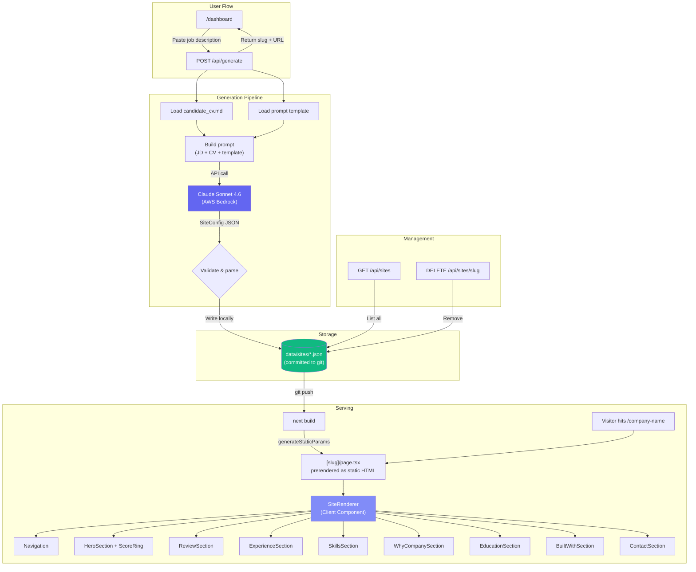

# Application Generator

Generate personalized, animated job application websites from any job description. Instead of sending a PDF resume, send a live URL.

**Paste a job description. Get a website.**

## How It Works

1. Open the dashboard (`/dashboard`)
2. Paste a job description into the textarea
3. Click **Generate Application**
4. Wait ~15-30 seconds while Claude analyzes the job and your CV
5. Get a live URL (e.g., `/caidera`) to a fully personalized application site

Each generated site includes:

- **AI Candidate Review** -- job requirements matched against real CV evidence with scores
- **Experience Timeline** -- work history with highlights tailored to the specific role
- **Skills & Technologies** -- proficiency bars with job-relevant tags highlighted
- **Why This Company** -- 5-6 specific, non-generic motivation reasons
- **Education & Research** -- academic background and thesis details
- **How This Was Built** -- meta section showcasing the AI-assisted development workflow
- **Contact** -- email, LinkedIn, phone, languages, relocation info

All wrapped in a dark-themed, scroll-animated UI built with Framer Motion.

## Architecture



Generated configs are committed to the repo and prerendered into static HTML at build
time. There is no runtime storage service, so serving the sites costs nothing and stays
inside any free hosting tier. The tradeoff: generation happens on a local checkout, since
deployed filesystems are read-only.

**Stack:** Next.js 16, TypeScript, React 19, Tailwind CSS 4, Framer Motion, AWS Bedrock (Claude Sonnet)

## Project Structure

```
src/
  app/
    page.tsx                  # Redirects to /dashboard
    dashboard/page.tsx        # Dashboard UI
    [slug]/page.tsx           # Dynamic route -- renders generated sites
    api/
      generate/route.ts       # POST -- calls LLM, stores config
      sites/route.ts          # GET -- lists all generated sites
      sites/[slug]/route.ts   # GET/DELETE -- single site operations
  components/
    dashboard/                # Dashboard UI components
    site/                     # Application site components (props-driven)
  lib/
    types.ts                  # SiteConfig interface
    llm.ts                    # AWS Bedrock integration
    prompt.ts                 # LLM prompt template
    storage.ts                # Reads/writes data/sites/*.json
    candidate-cv.ts           # Loads candidate CV
data/
  candidate_cv.md             # Your full CV (edit this)
  sites/                      # Generated configs -- commit these to publish
```

## Setup

### Prerequisites

- Node.js 18+
- AWS account with Bedrock access (Claude Sonnet enabled in `eu-central-1`)
- Any host that runs `next build` (Vercel free tier is enough)

### Local Development

```bash
# Install dependencies
npm install

# Create .env.local with your credentials
cp .env.example .env.local
# Edit .env.local with your AWS keys

# Start dev server
npm run dev
```

Open [http://localhost:3000/dashboard](http://localhost:3000/dashboard).

### Environment Variables

| Variable | Required | Description |
|---|---|---|
| `AWS_ACCESS_KEY_ID` | Yes | AWS access key with Bedrock permissions |
| `AWS_SECRET_ACCESS_KEY` | Yes | AWS secret key |
| `AWS_REGION` | Yes | AWS region (e.g., `eu-central-1`) |

### Publishing a Generated Site

Generation is local-only, so publishing is a git push:

```bash
npm run dev                       # generate at /dashboard
git add data/sites/<slug>.json
git commit -m "Add <company> application"
git push                          # host rebuilds and prerenders the new page
```

The deployed dashboard is read-only -- it lists existing sites but cannot generate or
delete them, because deployed filesystems cannot be written to.

### Deploy to Vercel

1. Push this repo to GitHub
2. Import the repo on [vercel.com](https://vercel.com)
3. Add the three environment variables above in project settings
4. Deploy

Every generated site gets a URL like `your-app.vercel.app/company-name`.

## Customizing for Your Own CV

1. Edit `data/candidate_cv.md` with your full work history, education, and skills
2. Update the contact details in `src/lib/prompt.ts` (education, contact, and builtWith sections in the prompt template)
3. Redeploy

The LLM uses your CV as the source of truth -- it will never fabricate experiences or skills not present in the file.

## Built With

This entire project -- from architecture to implementation -- was built using [Claude Code](https://claude.ai/claude-code) as an AI pair programmer.
