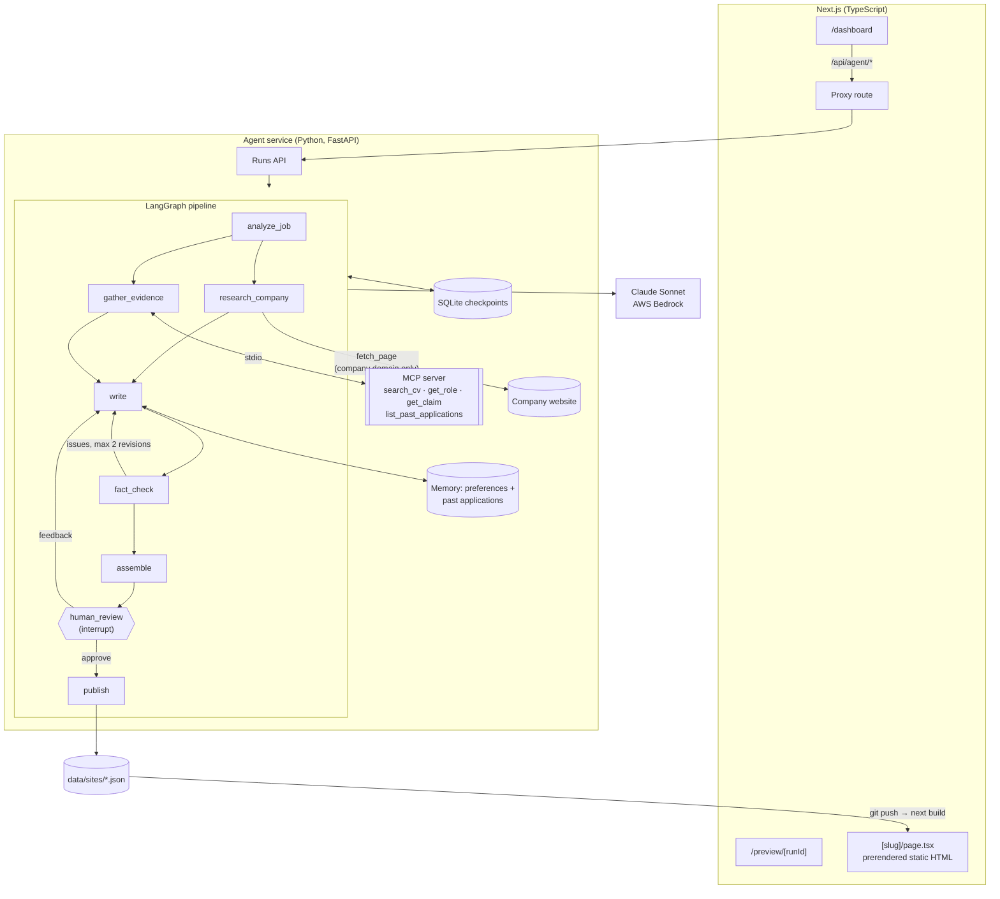

# Application Generator

Generate personalized, animated job application websites from any job description. Instead of sending a PDF resume, send a live URL.

**Paste a job description. A team of agents writes the site. You approve it. It goes live.**

Generation runs as a multi-agent pipeline (Python, LangGraph, AWS Bedrock, MCP). Every statement
on a generated site cites the CV lines it is based on, and a fact-checker rejects anything the CV
does not support before you see it.

## How It Works

1. Start the agent service and the Next.js app (see [Local Development](#local-development))
2. Open the dashboard (`/dashboard`), paste a job description and, optionally, the company website
3. Watch the agents work step by step (about 3-4 minutes)
4. Review the draft: requirement-by-requirement match levels, any statements the fact-checker
   could not verify, and a full preview
5. **Approve**, **request changes** with feedback, or **reject**
6. Approved sites are written to `data/sites/<slug>.json`; commit and push to publish

Each generated site includes:

- **Candidate Review** -- every key requirement labelled Strong, Partial or Gap, with evidence from the CV
- **Experience Timeline** -- every role, with highlights tailored to the specific job
- **Skills & Technologies** -- job-relevant skills highlighted, each tied to a project
- **Why This Company** -- 5-6 reasons, each linking a real company fact to real experience
- **Education & Research** and **Contact** -- copied verbatim from `data/profile.json`, never written by the LLM

## Architecture



### The agents

| Node | What it does |
|---|---|
| `analyze_job` | Turns the job description into 5-8 single-capability requirements (must / nice) |
| `research_company` | Tool-using agent that reads the company's own website (max 3 fetches, one domain, follows real links) and returns facts with source URLs; facts citing pages it never fetched are dropped |
| `gather_evidence` | Tool-using agent that cannot see the CV directly; it searches it through the MCP server and labels each requirement Strong / Partial / Gap |
| `write` | Writes all site content; every statement must cite CV claim IDs (e.g. `nordfeld-logistics-3`). The CV sits behind a Bedrock prompt-cache point, so revisions are cheap |
| `fact_check` | Rule checks (cited IDs exist, every role present, no invented years of experience, no must-have requirement skipped) plus an LLM judge that compares each statement with only the claims it cites. Statements that already passed are not re-judged |
| `human_review` | Pauses the graph with `interrupt()`; the run survives a service restart because state is checkpointed in SQLite |
| `publish` | Validates the final JSON against the `SiteConfig` schema and writes it |

### Guardrails and circuit breakers

- **Schema validation with retry:** every LLM step returns Pydantic-validated structured output via tool use; validation errors are fed back to the model, at most 2 retries
- **Grounding:** claim-level citations, checked twice (rules and judge); fixed facts are injected from `data/profile.json` and the CV, never generated
- **Bounded loops:** max 2 fact-check revisions, max 3 human revision rounds, per-agent tool budgets, a duplicate-tool-call breaker, LangGraph `recursion_limit`, and a per-run token budget. When a breaker trips, the run goes to human review with the open issues instead of looping
- **Tool safety:** the web tool only fetches the company's own domain (redirects included); MCP tool errors are returned to the model rather than crashing the run
- **Human in the loop:** nothing is published without approval

### Evaluation

`agent/evals/` holds 10 job descriptions (strong fits, partial fits and clear mismatches such as Java,
iOS and data engineering roles) with expected gaps and strengths. The harness runs both the
multi-agent pipeline and the original single-call generator (kept in `evals/baseline_prompt.ts`) and
scores them with the same independent audit:

- schema validity
- unsupported-claim rate (audit judge with the full CV)
- invented tenure claims
- gaps labelled honestly / strengths recognised
- latency and cost
- for the pipeline: tool success rate, duplicate calls, off-domain fetches, requirement search coverage, revision passes, circuit-breaker trips

```bash
cd agent
uv run appgen-eval                                     # all cases, ~$1 per case
uv run appgen-eval --cases opsfleet java-backend       # a subset
```

Results are written to `agent/evals/results/`. First run on 3 cases (Opsfleet, a Java backend
mismatch, an LLM-evaluation research role):

| Metric | Multi-agent pipeline | Original single call |
|---|---|---|
| Unsupported-claim rate (independent audit) | 1.8% | 9.3% |
| Expected gaps labelled honestly | 6/6 | 0/3 |
| Expected strengths recognised | 1/1 | 1/1 |
| Schema-valid output | 3/3 | 3/3 |
| Tool success rate / duplicate calls / off-domain fetches | 100% / 0 / 0 | n/a |
| Mean latency / cost per site | 153 s / $0.50 | 54 s / $0.11 |

The single call labelled Java, Kafka and JUnit "Strong Match" for a candidate with no Java, and
inflated "87,939 judgments" to "90k+". The pipeline's in-loop fact-checker is deliberately stricter
than the audit, so most runs still reach human review with 1-3 flagged statements.

**Stack:** Next.js 16, TypeScript, React 19, Tailwind CSS 4, Framer Motion · Python 3.12, LangGraph, LangChain AWS (Bedrock Converse), MCP (FastMCP + langchain-mcp-adapters), FastAPI, Pydantic, SQLite

## Project Structure

```
agent/                        # Python agent service (uv project)
  src/appgen/
    graph.py                  # LangGraph pipeline (nodes, routing, interrupt)
    llm.py                    # Bedrock models, validated structured output, bounded tool loop
    mcp_server.py             # MCP server exposing the CV and past applications
    cv.py                     # Parses candidate_cv.md into citable claims + BM25 search
    checks.py                 # Rule-based fact checks
    assemble.py               # Builds SiteConfig from draft + CV + profile
    web.py                    # Domain-restricted fetch tool
    memory.py                 # Preferences and application history (SQLite)
    service.py                # FastAPI API used by the dashboard
    runner.py                 # CLI: generate without the dashboard
    baseline.py, evaluate.py  # Original single-call version + eval harness
  evals/                      # Job description cases, expected labels, results
src/
  app/
    dashboard/page.tsx        # Dashboard: start runs, watch steps, review, preferences
    preview/[runId]/page.tsx  # Full preview of a draft awaiting review
    [slug]/page.tsx           # Published sites (prerendered)
    api/agent/[...path]/      # Proxy to the agent service (local only)
    api/sites/                # List / read / delete published sites
  components/site/            # Application site components (props-driven)
  components/dashboard/       # Dashboard components
data/
  candidate_cv.md             # Your full CV (the only source of truth about you)
  profile.json                # Education, contact, languages: inserted verbatim
  sites/                      # Published configs -- commit these to publish
```

## Setup

### Prerequisites

- Node.js 20+
- [uv](https://docs.astral.sh/uv/) (installs Python 3.12 for you)
- AWS account with Bedrock access (Claude Sonnet enabled in `eu-central-1`)

### Local Development

```bash
npm install
cp .env.example .env.local        # add AWS credentials, or use an AWS profile

# Terminal 1: agent service on http://127.0.0.1:8000
cd agent && uv sync && uv run appgen-service

# Terminal 2: Next.js
npm run dev
```

Open [http://localhost:3000/dashboard](http://localhost:3000/dashboard).

Without the dashboard: `cd agent && uv run appgen evals/cases/opsfleet.md --company-url https://www.opsfleet.com`
(dry run; add `--publish` to write the site).

The MCP server also runs standalone (`uv run appgen-mcp`), so any MCP client can query the CV.

### Environment Variables

| Variable | Required | Description |
|---|---|---|
| `AWS_ACCESS_KEY_ID` / `AWS_SECRET_ACCESS_KEY` | One of these or `AWS_PROFILE` | Bedrock credentials (read from `.env.local` or the standard AWS credential chain) |
| `AWS_REGION` | No | Defaults to `eu-central-1` |
| `BEDROCK_MODEL_ID` / `BEDROCK_JUDGE_MODEL_ID` | No | Writer and judge models (default Claude Sonnet 4.6) |
| `TOKEN_BUDGET` | No | Per-run token circuit breaker (default 400k) |
| `AGENT_SERVICE_URL` | No | Where Next.js finds the agent service (default `http://127.0.0.1:8000`) |

### Publishing a Generated Site

```bash
git add data/sites/<slug>.json
git commit -m "Add <company> application"
git push                          # host rebuilds and prerenders the new page
```

The deployed app only serves the static sites; the dashboard, preview and agent API are local only.

## Customizing for Your Own CV

1. Edit `data/candidate_cv.md` (keep the `### Title | Company | Location | Period` headings and `- ` bullets; each bullet becomes a citable claim)
2. Edit `data/profile.json` with your education and contact details
3. Optionally add writer preferences in the dashboard (e.g. "Never claim production LangGraph experience")

## Built With

Built with [Claude Code](https://claude.ai/claude-code) and [Cursor](https://cursor.com) as AI pair programmers.
